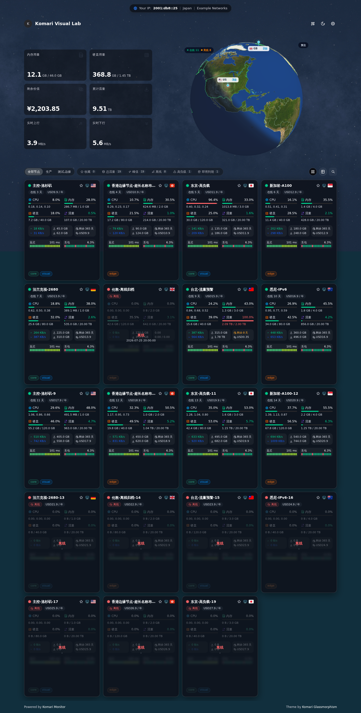
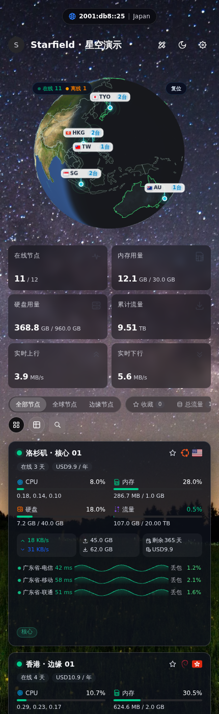

# 星空（Starfield）

面向 Komari Monitor 的 Vue 3 / TypeScript 派生访客主题。独立维护，不是 Komari 官方产品。

## 功能

- Emerald 3D 地球：NASA 海岸浅蓝贴图、晨昏光照、大气、国界和节点连线。
- 稳定的小城市标签，显示完整城市代码和台数；点击或触屏选择后显示城市汇总上下行及全部机器名称、在线/离线状态，长名单可滚动。
- 亮暗模式的城市详情采用不透明背景，避免底层统计透字。
- 毛玻璃节点卡片、列表、访客位置、响应式布局与三网延迟/丢包。
- 原创程序星空默认背景和几何地球 favicon；可在主题设置中使用自己的合法图片。

## 安装与兼容

本版本为访客前端主题，不包含后端或独立管理后台。源码支持 Komari 1.2.6 Metric Store 接口及旧 records 回退；Komari 1.5+ 的 /admin、/terminal 由后端内置前端提供。标准主题 ZIP 路径已在隔离环境验证；这不等于对全部后端版本或物理手机完成认证。高级工具、访客位置、审计等功能需要后端相应接口和权限，缺失时不可据此保证可用。

1. 从 [Releases](https://github.com/luhaihui106/komari-theme-starfield/releases) 下载 komari-theme-Starfield-build-*.zip，并核对 SHA256SUMS。
2. 登录 Komari 后台，进入主题管理，上传 ZIP，然后应用 Starfield（星空）。
3. ZIP 根目录包含 komari-theme.json、dist/ 和许可证；请勿上传 GitHub 自动生成的 Source code.zip。
4. 远程导入可使用 Release 中该 ZIP 的公开下载地址。上传会替换同名主题，操作前保留原主题包与设置。

自 v0.1.7 起品牌为 星空（Starfield），内部 name/short 为 Starfield，公开仓库为 komari-theme-starfield。这是独立安装主题，不覆盖 GlassEmerald 主题或自动迁移其后端设置；请手动选择并配置新主题。旧 v0.1.6 标签和发行附件保留原字节。地球 renderer 的 emerald 值及浏览器位置缓存键 glass-emerald-globe-position-v1 保留为兼容实现标识，不代表后端设置迁移。

## 预览

以下均为虚构 demo 数据，不是真实监控节点；桌面/手机 Chromium 视口模拟，不宣称实机 Safari 验证。




## 来源与许可

派生代码来源：sanrokamlan-prog/komari-theme-Glassmorphism、towersip/komari-theme-Glassmorphism、Tokinx/komari-theme-emerald。保留上游及本项目 MIT 版权文本。

原创贡献包含程序星空、几何 favicon、通用系统标识、地球光照与城市交互实现。NASA 图像不是本项目原创；Natural Earth 地理数据为公共领域衍生；Twemoji 国旗为 CC BY 4.0；Gentoo 标识为 CC BY-SA 2.5；其他图标按各自许可。详见 LICENSE、THIRD_PARTY_NOTICES.md、CANDIDATE_NOTICES.md、NASA_TEXTURE.md、ASSET_PROVENANCE.md 和 docs/asset-evidence/。中性 bump 不代表真实地形。

## 开发与验证

要求 Node.js ^20.19.0 或 >=22.12.0，固定 Bun 1.3.14。不要提交真实 .env、Cookie、Token 或节点数据。

```sh
bun install --frozen-lockfile
bun run lint
bun run type-check
bun test ./test/*.test.ts
bunx vitest run test/runtime
bun run security:public
bun run build
bunx playwright install chromium
bun run test:visual
```

静态安装包以源提交短 hash 命名资源目录；构建使用 SOURCE_DATE_EPOCH 实现可重复打包。API 开发目标可由 VITE_API_TARGET 指定，默认仅本机。tests/visual/fixtures/komari.ts 提供虚构 API 数据。

## 隐私与商标

访客审计为后端明确 opt-in；主题隐藏按钮不是后端授权机制。管理员应评估访客 IP/位置及第三方定位请求的隐私影响，见 PRIVACY.md。

Komari、品牌与系统名称归各自权利人所有，仅用于兼容或识别，不表示赞助、认可或隶属关系。这个干净公开快照不包含原私有 Git 历史、旧发行包或生产截图。
